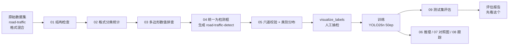
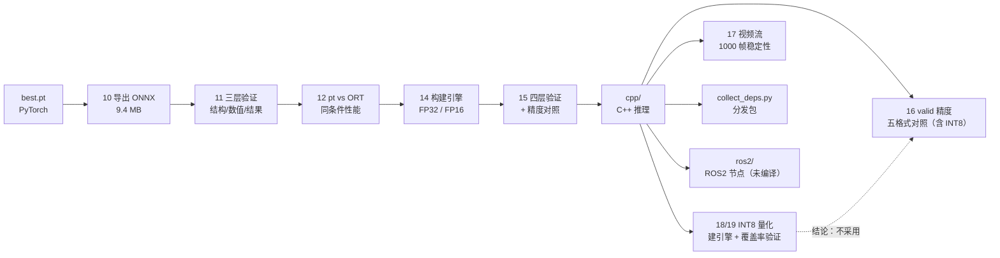

# 架构说明

YOLO 道路目标检测项目（Ultralytics YOLO26n · road-traffic 数据集 · 12 类）。

## 1. 一句话定位

目的不是"把模型训出来"，而是把一条**可复现、可追溯、别人能接手**的数据处理链路走通：
数据检查 → 标注格式统一 → 数据验收 → 训练 → 评估 → 推理 → 跟踪。

每一步都有独立脚本，每个脚本都打印可核对的数字，所有结论性数字都**连同测量条件**记录。

## 2. 数据管线

左侧三步（01→03）是**证明数据可用**，中间（04→05）是**改造数据**，右侧是**使用数据**。

## 3. 脚本分层

| 层 | 脚本 | 职责 | 是否写文件 |
|---|---|---|---|
| **配置层** | `dataset_config.py` | 唯一的路径与类别来源，向上查找项目根 | 否 |
| **数据检查** | `01` `02` `03` | 只读检查：配对、字段数、数值合法性 | 否 |
| **数据改造** | `04` `05` | 生成新数据集 + 验收 | **是**（生成 `road-traffic-detect/`） |
| **人工抽检** | `visualize_labels.py` | 把标注画回原图，人眼看 | 是（存图） |
| **训练** | Ultralytics CLI | 迁移学习 | 是（`runs/`） |
| **评估** | `09_evaluate.py` | 测试集一次性评估 + 报告 | 是（`results/eval_report/`） |
| **推理演示** | `06` `07` `08` | 图/视频/摄像头、对照拼图、ByteTrack | 是（`results/`） |
| **质量保障** | `benchmark_inference.py` `check_data_leakage.py` | 性能口径、数据泄漏 | 是（JSON） |
| **部署·导出** | `10` `11` `12` | 导出 ONNX、三层验证、pt/ORT 同条件对比 | 是（`docs/deployment/`） |
| **部署·引擎** | `14` `15` `16` | 构建 TRT 引擎、四层验证、valid 精度对照 | 是（同上） |
| **部署·交付** | `13` `17` | C++ 两后端对比、合成测试视频（仅验链路） | 是（同上） |

## 4. 部署管线（Windows 侧已完成 · ROS2 侧待验证）

训练产出的是 `best.pt`——它只能在 PyTorch 里用。部署要回答的是另一个问题：
**换一个运行时、换一种语言、换一台机器，还对不对、还快不快。**

部署管线的三个分界点：

| 分界 | 之前 | 之后 | 为什么不可逆 |
|---|---|---|---|
| **导出 ONNX** | 只有 pt 能用 | 任何装了 ORT 的环境都能用 | 一旦下游基于 onnx 建了基线，改导出参数就要把验证全部重做 |
| **构建 engine** | 通用（能跨显卡） | **绑死显卡架构 + TensorRT 版本 + 驱动** | 换机器必须重建，不能拷。Windows 构建的 Linux 也加载不了 |
| **换后处理路径** | 训练时的原生 NMS | onnx 侧自己实现的 decode + NMS | 两侧结果不再逐值相同，只能逐框比 IoU |

逐行的实测数据、每个数字的读法、27 个坑，都在 `docs/deployment/README.md`。
本文件只讲结构，不重复那边的内容。

## 5. 目录职责

| 目录 | 内容 | 是否入库 |
|---|---|---|
| `scripts/` | 全部脚本，**可在任意目录下运行** | 是 |
| `datasets/road-traffic/` | 原始数据（Roboflow 导出，CC BY 4.0） | 是 |
| `datasets/road-traffic-detect/` | 04 号脚本生成的检测框数据集 | 是 |
| `docs/` | 转换报告、性能 JSON、泄漏 JSON、失败运行参数快照 | 是（审计证据） |
| `runs/detect/runs/road_baseline/` | 训练产物（权重、曲线、混淆矩阵） | 是 |
| `results/` | 抽检图、推理结果、对照拼图、跟踪视频、评估报告 | 是 |
| `site/` | GitHub Pages 站点（index / manual / media） | 是（自动发布） |
| `cpp/` | C++ 推理工程：源码、ABI 探针、依赖收集脚本、分发包 | 源码是；`build/` `dist/` 否 |
| `ros2/` | ROS2 封装的独立 colcon 工作区（未编译验证） | 是（无构建产物） |
| `docs/deployment/` | 部署实施记录 + 12 份实测 JSON + 两份分包清单 | 是（审计证据） |
| `weights/` | `yolo26n.pt` + `best.onnx` + 两个 engine（engine 不入库，绑显卡） | pt/onnx 是；engine 否 |

## 6. 关键设计决策

| 决策 | 理由 |
|---|---|
| **`dataset_config.py` 作为唯一配置源** | 换数据集只改 `data.yaml`，不用动任何脚本里的类别数/路径 |
| **`find_project_root()` 向上找 `datasets/`** | 脚本在任意目录启动都能定位项目根，消除"必须在根目录运行"的隐性要求 |
| **01~03 只读、不进改造** | 先证明"数据能用"，再动手改；03 号脚本专门证明"多边形只是格式不同，数值本身合法" |
| **04 号脚本 DEST 已存在就报错停下** | 不覆盖已有数据。要重跑得先改名或移走，避免误删 |
| **转换写审计报告** | `docs/label_conversion_report.txt` 记录每一条异常行，可复盘 |
| **训练前先人工抽检** | 脚本只能证明"格式合法"，证明不了"框包对了目标"。类别标错、框拖偏、整张漏标，脚本全发现不了 |
| **测试集只评估一次** | valid 用来挑模型调阈值；test 反复看就不再是"没见过的数据" |
| **性能必须报三种口径** | 同一份权重同一张图，换个测法能差一倍以上（实测 15.8 / 11.3 / 16.4 ms） |
| **`workers=0`** | Windows 上 DataLoader 用 spawn，配错会长时间无输出像卡死；主进程加载便于看报错 |
| **导出后必须做三层验证** | 结构 / 数值 / 结果各一层。"能跑出框"证明不了没坏——框可能整体偏了 3 像素 |
| **判断 FP16 用「同路径 FP32」当基准** | pt→onnx 本身就掉 0.0078（换了后处理路径）。拿 pt 的 0.641 当基准，会把这笔账算到 FP16 头上 |
| **精度判据放在「相对量」上** | 数值层最大绝对差 24.66 看着像坏了，但输出量级本身有 47.5，相对误差只有 7.09e-04 |
| **显存用 `cudaMemGetInfo`，不用 `nvidia-smi` 差值** | 后者单次 101–107 ms（比一帧推理大 30–50 倍），且程序退出时显存全释放，实测前后差 −9 MB |
| **GPU 不打包运行时** | 3 GB 且版本必须严丝合缝（缺 nvrtc 时 TRT 静默回落）。改为轻包 + 目标机装运行时 |
| **打包用脚本读导入表，不手工拷 DLL** | 手工拷漏过两次，其中一次是包里的 exe 是旧版，跑 `--ep trt` 静默走了 CUDA EP |
| **INT8 校准集用 train，不用 valid** | valid 是量化效果的评估集，拿它校准会让 mAP 偏乐观；框架默认恰是 `split=val`，必须显式改 |
| **量化先查覆盖率，再看速度** | 覆盖率低时「不快」是构建没量化下去，不是模型不适合量化，两者改进方向相反 |
| **INT8 不采用（本项目）** | 卷积 81% 已 INT8 化仍只快 1.5%–3%（在噪声内），mAP50 掉 4.41%；小模型在桌面卡是访存受限 |

## 7. 数据流的三个分界点

这套链路上有三处"一旦跨过就不能回头"的地方：

| 分界 | 之前 | 之后 | 不可逆的原因 |
|---|---|---|---|
| **04 号生成新数据集** | 原始混合格式 | 统一检测框 | 后续所有训练都基于它，换回去指标不可比 |
| **训练完成** | 无可评估模型 | 有 `best.pt` | 权重与数据版本、参数、随机种子绑定 |
| **测试集评估** | test 是"没见过的数据" | 已被看过 | 再调参就会污染，报出来的数字虚高 |

这三处都在文档里明确标注了，提醒后来者不要重复踩。
