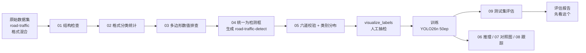

# 架构说明

YOLO 道路目标检测项目（Ultralytics YOLO26n · road-traffic 数据集 · 12 类）。

## 1. 一句话定位

目的不是"把模型训出来"，而是把一条**可复现、可追溯、别人能接手**的数据处理链路走通：
数据检查 → 标注格式统一 → 数据验收 → 训练 → 评估 → 推理 → 跟踪。

每一步都有独立脚本，每个脚本都打印可核对的数字，所有结论性数字都**连同测量条件**记录。

## 2. 数据管线

左侧三步（01→03）是**证明数据可用**，中间（04→05）是**改造数据**，右侧是**使用数据**。

## 3. 脚本分层

| 层 | 脚本 | 职责 | 是否写文件 |
|---|---|---|---|
| **配置层** | `dataset_config.py` | 唯一的路径与类别来源，向上查找项目根 | 否 |
| **数据检查** | `01` `02` `03` | 只读检查：配对、字段数、数值合法性 | 否 |
| **数据改造** | `04` `05` | 生成新数据集 + 验收 | **是**（生成 `road-traffic-detect/`） |
| **人工抽检** | `visualize_labels.py` | 把标注画回原图，人眼看 | 是（存图） |
| **训练** | Ultralytics CLI | 迁移学习 | 是（`runs/`） |
| **评估** | `09_evaluate.py` | 测试集一次性评估 + 报告 | 是（`results/eval_report/`） |
| **推理演示** | `06` `07` `08` | 图/视频/摄像头、对照拼图、ByteTrack | 是（`results/`） |
| **质量保障** | `benchmark_inference.py` `check_data_leakage.py` | 性能口径、数据泄漏 | 是（JSON） |

## 4. 目录职责

| 目录 | 内容 | 是否入库 |
|---|---|---|
| `scripts/` | 全部脚本，**可在任意目录下运行** | 是 |
| `datasets/road-traffic/` | 原始数据（Roboflow 导出，CC BY 4.0） | 是 |
| `datasets/road-traffic-detect/` | 04 号脚本生成的检测框数据集 | 是 |
| `docs/` | 转换报告、性能 JSON、泄漏 JSON、失败运行参数快照 | 是（审计证据） |
| `runs/detect/runs/road_baseline/` | 训练产物（权重、曲线、混淆矩阵） | 是 |
| `results/` | 抽检图、推理结果、对照拼图、跟踪视频、评估报告 | 是 |
| `site/` | GitHub Pages 站点（index / manual / media） | 是（自动发布） |
| `weights/` | 预训练权重 `yolo26n.pt` | 是 |

## 5. 关键设计决策

| 决策 | 理由 |
|---|---|
| **`dataset_config.py` 作为唯一配置源** | 换数据集只改 `data.yaml`，不用动任何脚本里的类别数/路径 |
| **`find_project_root()` 向上找 `datasets/`** | 脚本在任意目录启动都能定位项目根，消除"必须在根目录运行"的隐性要求 |
| **01~03 只读、不进改造** | 先证明"数据能用"，再动手改；03 号脚本专门证明"多边形只是格式不同，数值本身合法" |
| **04 号脚本 DEST 已存在就报错停下** | 不覆盖已有数据。要重跑得先改名或移走，避免误删 |
| **转换写审计报告** | `docs/label_conversion_report.txt` 记录每一条异常行，可复盘 |
| **训练前先人工抽检** | 脚本只能证明"格式合法"，证明不了"框包对了目标"。类别标错、框拖偏、整张漏标，脚本全发现不了 |
| **测试集只评估一次** | valid 用来挑模型调阈值；test 反复看就不再是"没见过的数据" |
| **性能必须报三种口径** | 同一份权重同一张图，换个测法能差一倍以上（实测 15.8 / 11.3 / 16.4 ms） |
| **`workers=0`** | Windows 上 DataLoader 用 spawn，配错会长时间无输出像卡死；主进程加载便于看报错 |

## 6. 数据流的三个分界点

这套链路上有三处"一旦跨过就不能回头"的地方：

| 分界 | 之前 | 之后 | 不可逆的原因 |
|---|---|---|---|
| **04 号生成新数据集** | 原始混合格式 | 统一检测框 | 后续所有训练都基于它，换回去指标不可比 |
| **训练完成** | 无可评估模型 | 有 `best.pt` | 权重与数据版本、参数、随机种子绑定 |
| **测试集评估** | test 是"没见过的数据" | 已被看过 | 再调参就会污染，报出来的数字虚高 |

这三处都在文档里明确标注了，提醒后来者不要重复踩。
