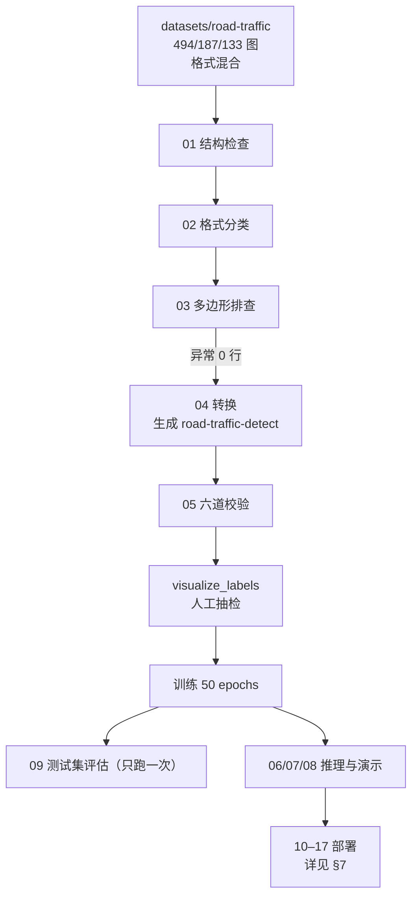
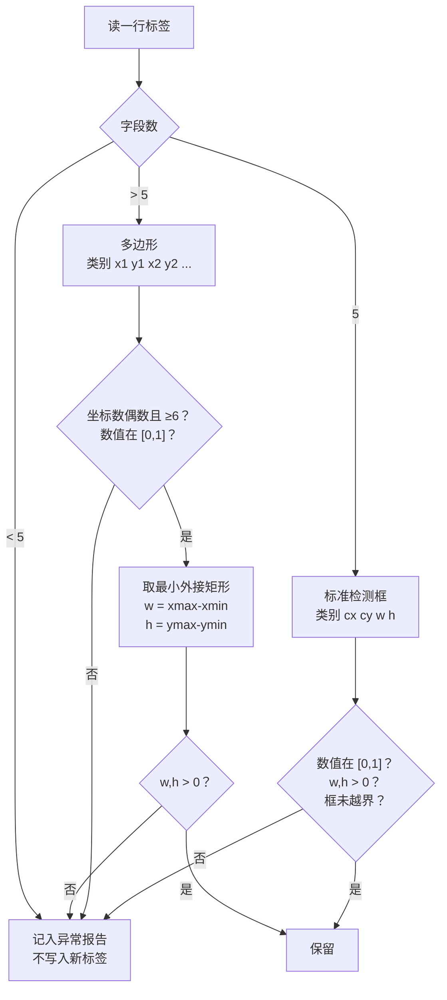

# 执行流程

从原始数据集到"能演示、能复现、指标可解释"的完整链路。

## 1. 总览

上面这张图只画到"演示"。**部署是另一条支线**，从 `best.pt` 出发，走 ONNX → TensorRT → C++，
见 §7。

## 2. 逐步输入 / 输出 / 判据

| 步 | 脚本 | 输入 | 输出 | 通过判据 |
|---|---|---|---|---|
| 1 | `01_check_dataset.py` | 原始 train/valid/test | 控制台报告 | 图片与标签一一对应、每行 5 字段、类别不越界、坐标在 [0,1] |
| 2 | `02_inspect_label_formats.py` | 同上 | 格式分类统计 | 明确"混了几种格式"：train 1801+3 / valid 35+804 / test 469+53 |
| 3 | `03_find_bad_coordinates.py` | 同上 | 异常行清单 | **三个划分异常多边形行数均为 0** |
| 4 | `04_convert_labels_to_detection.py` | 原始数据集 | 新数据集 + `docs/label_conversion_report.txt` | 转换无异常行；目标目录不存在 |
| 5 | `05_validate_detection_dataset.py` | 新数据集 | 六道校验 + 逐类框数 | 0 异常、0 空标签 |
| 6 | `visualize_labels.py` | 新数据集 | `results/label_check/*.png` | 人眼确认框包对了目标 |
| 7 | `benchmark_inference.py` | `best.pt` | `docs/inference_benchmark.json` | 三档计时 + 5 项条件齐全 |
| 8 | `check_data_leakage.py` | 数据集 | `docs/data_leakage_report.json` | 内容 0 重复；时间戳重叠需如实记录 |
| 9 | Ultralytics train | 新数据集 + `yolo26n.pt` | `runs/.../best.pt` | mAP 曲线收敛、无 NaN |
| 10 | `09_evaluate.py --split test` | `best.pt` + test | `results/eval_report/` | 一次性，跑前想清楚 |
| 11 | `06_predict.py` | `best.pt` + 图/视频/摄像头 | `results/predict/` | 能出框、能出 summary.json |
| 12 | `07_make_demo_figure.py` | 预测结果 + 标注 | `results/demo/demo_grid.png` | 挑选规则写入 json 可复算 |
| 13 | `08_track.py` | 真实道路视频 | `results/track/<name>/track.mp4` | 用真人拍的视频，不用快照集 |

## 3. 第 4 步的转换逻辑

**异常行不写入新标签**，只记入报告。这是刻意的：宁可让数据少一行，
也不能把一条算错的框混进训练集——那会变成模型学到的"真理"。

## 4. 数据流的实际数字

| 阶段 | train | valid | test | 合计 |
|---|---|---|---|---|
| 图片 | 494 | 187 | 133 | 814 |
| 原始标准框行 | 1801 | 35 | 469 | 2305 |
| 转换的多边形行 | 3 | 804 | 53 | **860** |
| 标注框总数 | 1804 | 839 | 522 | 3165 |
| 异常行 | 0 | 0 | 0 | 0 |

转换后 valid 从 35 个框变成 839 个——因为 valid 几乎全是多边形标注。

## 5. 训练与评估的分界

| 阶段 | 用什么数据 | 能做什么 | 不能做什么 |
|---|---|---|---|
| 训练 | train | 学参数 | — |
| 调模型 | **valid** | 挑轮次、看曲线、调阈值 | — |
| 最终评估 | **test** | **只能跑一次** | 反复看后再调参 |

三者的数字**本来就应该不同**，不是 bug：

| 指标 | valid（挑模型用） | test（留出一次） |
|---|---|---|
| mAP50 | 0.644（第 19 轮最高） | **0.680** |
| mAP50-95 | 0.416（第 48 轮最高） | **0.423** |
| best.pt 对应轮次 | 第 48 轮（按 `fitness = 0.1×mAP50 + 0.9×mAP50-95`） | — |

## 6. 推理产物的区分（容易混）

| 产物 | 脚本 | 它说明什么 | **不**说明什么 |
|---|---|---|---|
| `results/predict/summary.json` | `06` | 模型**输出了几个框**、类别分布 | **不是正确率** |
| `results/demo/demo_grid.png` | `07` | 绿=正确、黄=漏检、红=误检，直观看到哪行哪不行 | 不是定量指标 |
| `results/eval_report/` | `09` | 定量 mAP / P / R | 不代表真实道路场景表现 |
| `results/track/*.mp4` | `08` | 跟踪链路能跑通、ID 是否稳定 | 快照集上跑的数字**没有意义** |

**"模型敢不敢报"和"它报得对不对"是两件事**，文档里必须分开说。

## 7. 部署流程（Windows 侧，8 步）

接在 §5 训练之后。它不只是"再跑几个脚本"——真正的难点是**换运行时的同时保持结果不变**。

| # | 步骤 | 需要什么 | 产出 | 判据 |
|---|---|---|---|---|
| 1 | `10_export_onnx.py` | `best.pt` | `weights/best.onnx` | 9.4 MB；读回结构（opset / 节点数 / 368 个算子）与预期一致 |
| 2 | `11_verify_onnx.py` | onnx + pt | `onnx_verify_report.json` | 三层全过：结构一致、数值相对误差 ~1e-4、**16 图 70 对 70、最小 IoU ≥ 0.99** |
| 3 | `12_benchmark_pt_vs_onnx.py` | 同一张图 | `benchmark_pt_vs_onnx.json` | 同条件、n ≥ 100、每次前后同步；记录三档口径 |
| 4 | `14_export_engine.py` | onnx + TensorRT | `best_fp32.engine` / `best_fp16.engine` | FP32 ≈ 18 MB（~2 min）；FP16 ≈ 12 MB（**~10 min**） |
| 5 | `15_verify_engine.py` | 两个引擎 + onnx | `engine_verify_report.json` | 四层验证（结构/数值/结果/精度）+ 三档性能同表 |
| 6 | `16_eval_valid_split.py` | 四种格式 | `valid_precision_compare.json` | 只评 valid；**FP32 → FP16 的 mAP50 差 < 0.005** |
| 7 | 构建 `cpp/` 并跑 | onnx + ORT | `cpp_result.json` / 端到端 / 视频报告 | 与 Python 侧逐框配对 IoU ≥ 0.98；端到端拆五段 |
| 8 | `cpp/collect_deps.py` | build 产物 | `cpp/dist/` + `MANIFEST.txt` | 把 PATH 清成只剩系统目录，仍能跑出正确结果 |

四个不能省的点：

- **第 2 步不能跳。** 跳过它，后面所有对比都没有可信基线——你不知道差异是"格式转换"带来的还是"本来就坏了"。
- **第 4 步的 engine 绑死本机。** 显卡架构 + TensorRT 版本 + 驱动三者任一变化都得重建。
  **Windows 构建的 engine 在 Linux 上加载不了**，反之亦然。
- **第 6 步只用 valid。** test 已经在 §5 用过一次，不再碰——第二次看它就不再是"没见过的数据"。
- **第 8 步不要手工拷 DLL。** 本项目手工拷漏过两次，其中一次是包里的 exe 是旧版，
  `--ep trt` 被静默忽略、走了 CUDA EP，全程不报错。

部署阶段的更细步骤（含每个数字怎么读、27 个坑）见 `docs/deployment/README.md`。

## 8. 一次完整复现需要固定什么

只有 `args.yaml` 不够，必须同时固定五项：

1. **数据版本**：Roboflow v1 + 第 4 步转换后的产物
2. **模型权重**：`yolo26n.pt` 的具体版本
3. **软件环境**：Python 3.11.16 / PyTorch 2.11.0+cu128 / Ultralytics 8.4.176
4. **代码版本**：脚本改动过就要重新记录
5. **随机性**：`seed=0`、`deterministic=true`

缺任何一项，"复现"就变成"重跑一次，结果差不多"。
